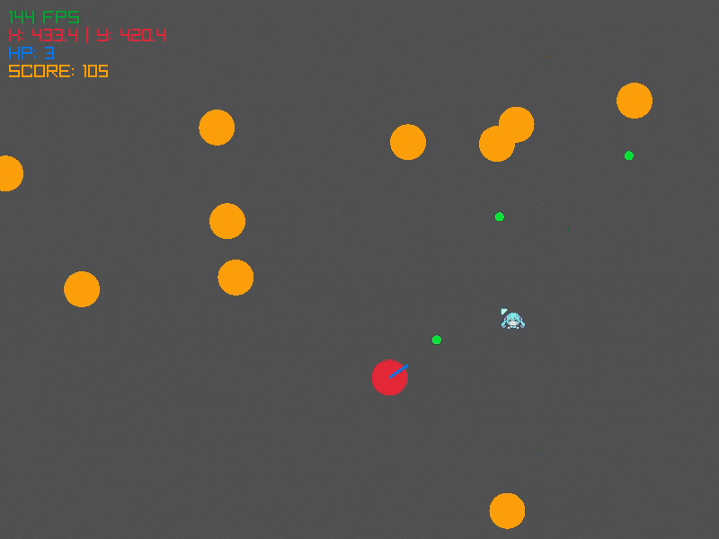

# 🎯 Raylib Survival Shooter


A fast-paced, 2D top-down survival shooter built from scratch using **modern C++20** and the **Raylib** framework. 

> **Note for Reviewers / HR:** This is an educational project designed to deeply explore game architecture. Instead of heavily relying on engine-provided black-box functions, core mechanics like **2D vector mathematics, collision detection, and entity pooling** were written from scratch. 



## ✨ Key Technical Features

As a learning initiative, this project emphasizes clean architecture and performance over quick prototyping:

* **Separation of Concerns:** The core game logic (`GameLogic`) is strictly decoupled from the rendering engine (`Renderer`). The renderer acts as a pure View, taking a read-only `GameState` Model.
* **Custom Mathematics:** Implemented a custom `Vec2` structure to handle normalization and dot/cross operations, ensuring the logic remains framework-agnostic.
* **Object Pooling:** To prevent memory fragmentation and performance spikes, entities (Enemies, Bullets) are pre-allocated using fixed-size `std::array` pools rather than dynamic allocations (`std::vector` / `new`).
* **Optimized Collision:** Uses squared distance checks for Circle-to-Circle collision detection, bypassing expensive `std::sqrt` CPU calls.
* **Strict Code Quality:** The build environment enforces severe compiler warnings (`/WX`, `-Werror`, `-Wpedantic`) to catch potential bugs at compile-time.

## 🛠️ Technology Stack

* **Language:** C++20
* **Framework:** [Raylib](https://www.raylib.com/) (Rendering, Input, Window management)
* **Build System:** CMake
* **Package Management:** vcpkg (Manifest Mode)
* **Documentation:** Doxygen

## 🎮 Controls

* **W, A, S, D** - Move player
* **Mouse** - Aim
* **Left Click** - Shoot
* **R** - Restart (on Game Over)

## 🚀 Getting Started

### Prerequisites
1. A C++20 compatible compiler (MSVC, GCC, or Clang).
2. [CMake](https://cmake.org/download/) (v3.20 or newer).
3. [vcpkg](https://vcpkg.io/en/getting-started.html) installed on your system.

### Build Instructions

1. **Clone the repository:**
   ```bash
   git clone https://github.com/Jellood/raylib-shooter.git
   cd raylib-shooter
    ```

2. **Configure the project with CMake:**
    Point CMake to your local vcpkg toolchain file. Because this project uses `vcpkg.json` manifest mode, dependencies will be downloaded and built automatically.
    ```bash
    cmake -B build -S . -DCMAKE_BUILD_TYPE=Release -DCMAKE_TOOLCHAIN_FILE="[path/to/your/vcpkg]/scripts/buildsystems/vcpkg.cmake"
    ```
    *(Replace `[path/to/your/vcpkg]` with your actual vcpkg installation path).*

3. **Build the game:**
    ```bash
    cmake --build build --config Release
    ```

4. **Run the executable:**
    * **Windows:** `build\Release\ShooterApp.exe`
    * **Linux / macOS:** `./build/ShooterApp`


## 📁 Architecture Overview

```text
├── assets/               # Media assets (images, gifs)
│   └── gameplay.gif      # Demo of the gameplay
├── include/              # Public Headers
│   ├── GameLogic.hpp     # Physics, inputs, collisions
│   ├── Math.hpp          # Custom 2D vector math
│   ├── Renderer.hpp      # Raylib drawing routines
│   └── Types.hpp         # Entity pools and core structs
├── src/                  # Implementation
│   ├── GameLogic.cpp     
│   ├── main.cpp          # Game loop with delta-time clamping
│   └── Renderer.cpp      
├── .gitignore            # Untracked files to ignore
├── CMakeLists.txt        # Universal build configuration
├── README.md             # Project documentation
└── vcpkg.json            # Dependency manifest (Raylib)
```

## 📝 License

This project is open-source and available under the [MIT License](https://opensource.org/license/mit).